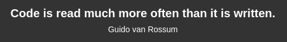
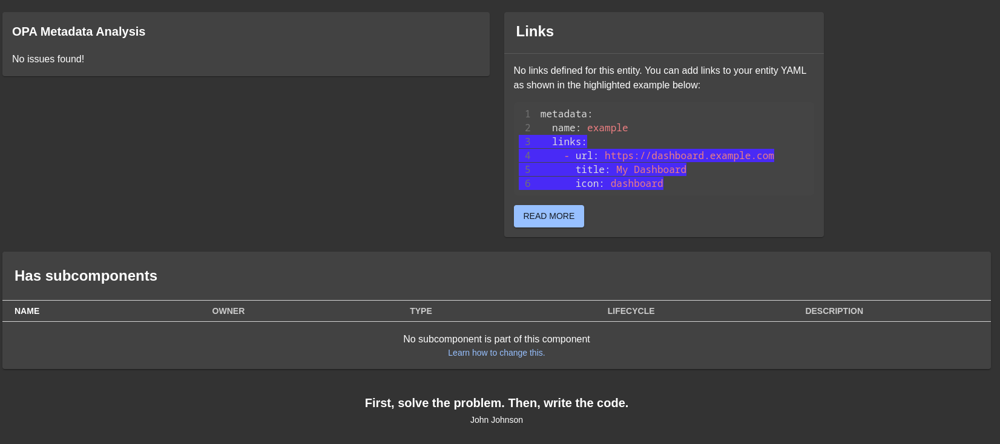

# dev-quotes-homepage

Hello! :wave:

This is just a fun little plugin that I made to display random coding/programming quotes anywhere in your Backstage app — homepage, entity pages, custom dashboards, whatever you like. I hope you enjoy it!

If you want to leave a star, that would be awesome! :star:

I don't expect much work to be done on this plugin as it was just a fun little project I made. But if you would like to contribute, please do! See [Would you like to contribute? or add more quotes?](#would-you-like-to-contribute-or-add-more-quotes) for more information.

> **From v4.0.0 onwards, this plugin only supports the Backstage New Frontend System (NFS).** The legacy frontend system (`createApp` from `@backstage/app-defaults`) is no longer supported. If you are on an older app setup, stay on v3.x or migrate your app first using the [Backstage frontend system migration guide](https://backstage.io/docs/frontend-system/building-apps/migrating). See the [CHANGELOG](./CHANGELOG.md) for full details and migration steps.

## Installation

```bash
yarn --cwd packages/app add @parsifal-m/plugin-dev-quotes-homepage
```

## Usage

The primary way to use this plugin is by importing the `DevQuote` component directly into any page — your homepage, an entity page, a custom dashboard, wherever you like:

```tsx
import { Grid } from '@material-ui/core';
import { DevQuote } from '@parsifal-m/plugin-dev-quotes-homepage';

const MyHomePage = () => (
  <Grid container spacing={3}>
    <DevQuote />
    {/* ... other cards */}
  </Grid>
);
```

### Adding custom quotes

Pass additional quotes via the `extraQuotes` prop. Each entry needs a `text` and `author` field — they are merged with the built-in quote list at runtime:

```tsx
import { DevQuote } from '@parsifal-m/plugin-dev-quotes-homepage';

<DevQuote
  extraQuotes={[
    { text: 'Ship it!', author: 'Every engineer ever' },
    { text: 'Make it work, make it right, make it fast.', author: 'Kent Beck' },
  ]}
/>;
```

## Example

An example quote



An example quote on an entity page:



## Would you like to contribute? or add more quotes?

Please do! I would love to see more quotes added to this plugin. If you would like to add some quotes, please open a pull request with your changes. If you would like to add a lot of quotes, please open an issue first so we can discuss it. And please keep them programming related, and keep it safe for work! Here is a short example of how to add a quote:

- Clone the repository and run `yarn install --immutable`
- Add the quote to the `quotes.ts` file in the `src` folder.
- Run `yarn prettier:write`
- Make sure to sign your commit with `git commit -s -m "Added quote by <someone>"`

## When will my quote be added to the plugin?

I will try and release a new version with the new quotes as soon as possible. Keep in mind this is a side project I made for fun!

## License

This project is released under the Apache 2.0 License.
